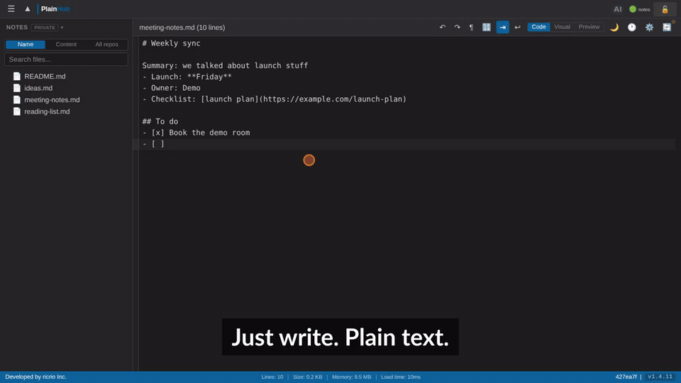
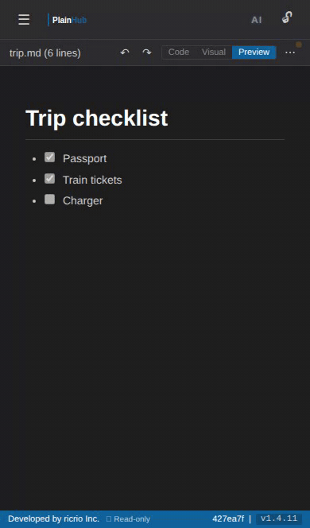

# PlainHub

**Your AI works in your GitHub. You decide.**

A GitHub editor, wired to Claude Code: your agent keeps a shared ledger of progress and decision cards in your own repo, and you approve from your browser or phone.

[](https://app.plainhub.dev)
[](https://www.npmjs.com/package/plainhub)

[Website](https://plainhub.dev) · ▶ [30-second intro (YouTube)](https://youtu.be/2ThRzBnGxoE) · [Documentation](#documentation) · [日本語ドキュメント](docs/ja/README.md)



## Three ways to use it

### 1. Edit — open, write, save

Open a file in your GitHub repositories, write, and save — no Git knowledge required. Every save is a commit in your own repository. Ask the AI about the file in front of you, and review each proposed edit before it is applied. → [User Guide](docs/USER_GUIDE.md)

### 2. Ledger — progress and decision cards in your repo

Your agents write their messages and decision cards as Markdown files in `.agents/` in your own repository. Send it to GitHub with `plainhub ledger sync .` and open the repository in PlainHub. If you can write to it, decision cards waiting for you show Approve and Decline buttons, on your PC or your phone. Starting a ledger needs only Git and Node.js 18 or later. → [How to use the ledger](https://www.npmjs.com/package/plainhub#use-without-plainhub)

### 3. Your agent — connect your own Claude Code

Ask in the PlainHub AI panel, and Claude Code on your own PC answers — from the same PC or from your phone. No API key needed: it uses your Claude subscription. → [Your agent](docs/YOUR_AGENT.md)

## Why PlainHub

- **GitHub-native** — Your files are saved only in your own GitHub repository. PlainHub doesn't store them.
- **File contents never pass through PlainHub's servers** — Reading and saving go directly between your browser and the GitHub API. Sign-in uses a small server step — see the [privacy policy](https://plainhub.dev/privacy).
- **BYOK (Bring Your Own Key)** — Use your own AI API keys (e.g., Anthropic Claude). Keys stay in your browser, never sent to PlainHub servers.
- **AI for idea development** — Brainstorm, write, and edit alongside an AI assistant. Voice input and TTS read-aloud supported.
- **Frontend for GitHub** — Like github.dev, but for non-engineers. A notepad with version control built in.

## Features

### Edit from your phone

Open a note on your phone, fix a line, and it is saved — as a commit in your own repository.



### Editor

- **Markdown 3-mode editing** — Code / Visual (WYSIWYG) / Preview
- **Syntax highlighting** — Markdown, JSON, YAML, and more
- **Undo / Redo** — Full edit history
- **Line numbers, auto-indent, line wrapping** — Configurable
- **Whitespace visualization** — Toggle invisible characters
- **Keyboard shortcuts** — VS Code-style shortcuts (Ctrl+S, Ctrl+Z, etc.)

### File Management

- **Create / rename / duplicate / delete** files and folders
- **File history** — View past versions with diff
- **Sync & conflict resolution** — Real-time sync with GitHub
- **Image paste** — Paste images directly, auto-upload to repo
- **Cross-repo search** — Search across all your repositories

### Integration

- **CLI** — `plainhub open <file> -r <repo>` from your terminal
- **MCP Server** — Control from AI IDE (Claude Code, Cursor, VS Code)
- **Deep linking** — Share URLs with theme, font size, line number settings
- **PWA** — Install as native app on desktop and mobile

### Design

- **Dark / Light theme** — Automatic or manual
- **Mobile responsive** — Full-featured on phone and tablet

## Quick Start

### Web

Visit **[plainhub.dev](https://plainhub.dev)** and sign in with GitHub.

### CLI

```bash
npm install -g plainhub
plainhub auth --from-gh
plainhub open README.md -r owner/repo
```

### MCP Server (AI IDE)

```bash
npm install -g plainhub
claude mcp add plainhub -- plainhub-mcp
```

Then say: *"Open the README in owner/repo on PlainHub"*

## Documentation

- **[User Guide](docs/USER_GUIDE.md)** — Editor features and shortcuts
- **[Features](docs/FEATURES.md)** — Key features, data ownership, enterprise
- **[Use Cases](docs/USE_CASES.md)** — When and how to use PlainHub
- **[CLI Reference](docs/CLI.md)** — Terminal commands and options
- **[MCP Server](docs/MCP_SERVER.md)** — AI IDE integration
- **[Your agent](docs/YOUR_AGENT.md)** — Connect your own Claude Code to the AI panel
- **[FAQ](docs/FAQ.md)** — Troubleshooting and common questions
- **[日本語ドキュメント](docs/ja/)** — Japanese documentation

## Ask / Report

Ask a question or report a problem: [open an issue](https://github.com/ricrio-inc/plainhub/issues/new/choose) — no question is too small. We usually reply within 2 business days.

- **❓ How do I…?** — ask how to do something
- **🐞 Bug** — something doesn't work as expected
- **💡 Idea** — suggest an improvement

Replies may be drafted with the help of an AI assistant and are checked by the PlainHub team. Please don't post personal information, tokens, or private file contents — this repository is public.

## Links

- **App**: [app.plainhub.dev](https://app.plainhub.dev)
- **About**: [plainhub.dev](https://plainhub.dev)

If PlainHub is useful to you, a star helps others find it.

## License

Copyright © 2025 [ricrio Inc.](https://ai.ricrio.jp/) All rights reserved.

<sub>The documents in this repository are generated from another place, so please don't edit them here. If something needs fixing, let us know with an [issue](https://github.com/ricrio-inc/plainhub/issues/new/choose).</sub>
